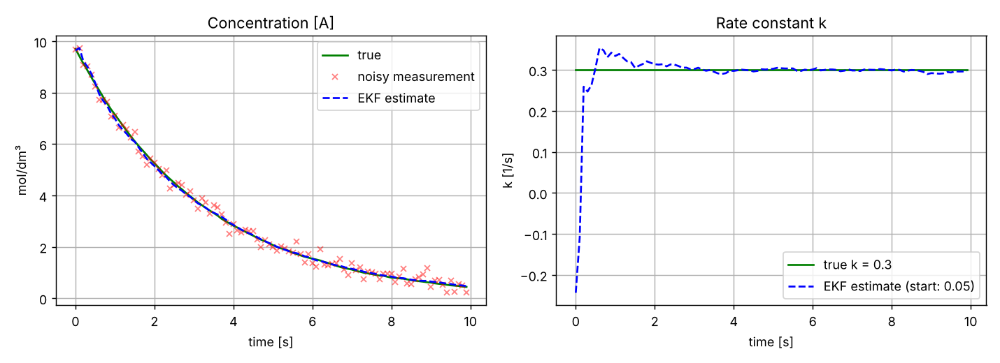

# Kalman Filter: Parameter Estimation in Reaction Kinetics

Linear and Extended Kalman filters implemented from scratch in NumPy, derived as special cases of the Bayes filter.
The Extended Kalman Filter (EKF) is used to estimate an **unknown reaction rate constant** from noisy concentration measurements.



## The problem

A first-order reaction A → products follows

$$\frac{d[A]}{dt} = -k\,[A]$$

Only the concentration [A] is measured, with Gaussian noise. The rate constant k is unknown.
To estimate it, k is added to the state vector, which makes the model nonlinear:

$$x_t = \begin{pmatrix} [A]_t \\ k_t \end{pmatrix}, \qquad
x_{t+1} = \begin{pmatrix} [A]_t - \Delta t \, k_t \, [A]_t \\ k_t \end{pmatrix} + \text{noise}, \qquad
y_t = [A]_t + \text{noise}$$

The EKF linearizes this model at every step using its Jacobian.

## Results

Simulation: 100 steps, Δt = 0.1 s, true k = 0.3 1/s, measurement noise σ = 0.2. The filter starts from a poor guess (k = 0.05).

| | Value |
|---|---|
| Estimated k after 10 s | 0.299 (true: 0.3) |
| Concentration RMSE, raw measurements | 0.199 |
| Concentration RMSE, EKF estimate | 0.073 |

The filter recovers k within about 3 seconds and reduces the concentration error by roughly 63% compared with the raw measurements.

**Note:** in the first step the estimate of k briefly becomes negative, which is physically impossible.
A natural improvement is to estimate log k instead of k, which keeps the rate constant positive.

## Files

| File | Description |
|---|---|
| `initialize.py` | `KalmanFilter` and `ExtendedKalmanFilter` classes (predict and correction steps) |
| `reaction.py` | Reaction model, its Jacobians, simulation of noisy data and the estimation loop |
| `show.py` | Plots the true, measured and estimated values and saves `ekf_result.png` |
| `Kalman_filter.pdf` | Full derivation from the Bayes filter, in Hungarian |

## How to run

```bash
pip install -r requirements.txt
python show.py
```

## Planned

- C++ implementation
- Estimating log k to enforce positivity
